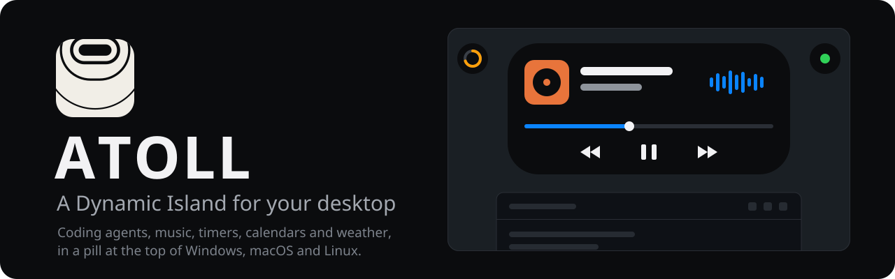

<div align="center">

<picture>
  <source media="(prefers-color-scheme: dark)" srcset="docs/assets/brand/banner-dark.svg">
  <source media="(prefers-color-scheme: light)" srcset="docs/assets/brand/banner-light.svg">
  
</picture>

**Coding agents, music, timers, calendars, weather and files, in a pill at the top of your screen.<br>Click it to open a panel. ATOLL runs on your own computer, with no account and no telemetry.**

[](https://github.com/Mazon3442/Atoll/releases/latest)
[](#install)
[](https://avaloniaui.net)
[](https://github.com/Mazon3442/Atoll/actions/workflows/release.yml)
[](https://github.com/Mazon3442/Atoll/releases)

[Features](#features) · [Install](#install) · [Quick start](#quick-start) · [Using ATOLL](#using-atoll) · [Privacy](#privacy) · [Build from source](#build-from-source) · [Releases](#releases) · [Troubleshooting](#troubleshooting)

</div>

## Features

ATOLL sits at the top of your primary display as a **compact** pill that shows the most important
thing happening. Hover over it or click it to **expand** it into grouped tabs, and press Escape to
collapse it again. Each module can be turned on or off in Settings.

| Feature | What it does |
| --- | --- |
| **Agents** | Activity from Claude Code, Codex, OpenCode and Hermes, with completion and attention alerts. Codex also reads recent local session events, including sessions already running when hooks were installed. Claude Code token and cost totals come from local transcripts and are estimates at API list prices. |
| **API providers** | An optional local gateway for OpenAI-compatible Chat Completions/Responses and official Anthropic Messages. It shows requests in progress and local token totals. OpenAI organization usage and costs are available with an optional admin key, and DeepSeek balance with a normal key. |
| **Media** | Pick a player in the source dropdown. Five bars take their color from its cover, adjusted for your theme. Play/pause, skip and seek when the player supports it. |
| **Clock & timers** | Clock, countdown presets, stopwatch and Pomodoro. |
| **Calendar** | Upcoming events from private HTTPS ICS links (Google, Outlook / Microsoft 365, ...), with pin and dismiss controls and alerts before events start. |
| **Weather** | Open-Meteo city search, current conditions and a seven-day forecast. Hourly wind, rain and temperature charts work with the pointer and the keyboard. |
| **Files** | A file shelf and clipboard history. History stays in memory, and private or password formats are skipped. |
| **System** | CPU, memory and network readings, volume and battery, and quick actions: screenshot, microphone mute, lock, display off and Downloads. |
| **Notifications** | Windows notifications mirrored into the island once you set up the package identity and allow access. |
| **Updates** | Windows installer copies download published releases in the background and apply them on restart. |

### Platform support

|  | Windows | macOS | Linux |
| --- | :---: | :---: | :---: |
| Agents, API gateway, clock, calendar, weather, file shelf | ✅ | ✅ | ✅ |
| Clipboard history | ✅ | ✅ | ✅ ¹ |
| Media sources | Any player | Music, Spotify ² | MPRIS via `playerctl` |
| Live audio bars | ✅ ³ | Cover color only | Cover color only |
| Volume and battery | ✅ | ✅ | PulseAudio / PipeWire |
| Quick actions | ✅ | ✅ | ✅ ⁴ |
| Notification mirroring | ✅ | ➖ | ➖ |
| Fullscreen/game handling, click-through | ✅ | Window manager | Window manager |
| Automatic updates | Installer copies | Download again | Package manager |

<sub>¹ Some desktops restrict clipboard access. ² macOS may ask for Automation permission.
³ Captures the selected app's audio where Windows can match its process; otherwise it falls back to a labeled system output.
⁴ Screenshot and display-off need desktop tools such as `gnome-screenshot` and `xset` (X11 only).</sub>

ATOLL's own agent, calendar and timer alerts work everywhere. Audio-only sources such as Discord can
appear on Windows and Linux without track details or playback controls.

> [!NOTE]
> The Windows package runs the WPF island, the same app `dotnet run --project src/Atoll.App` starts.
> Linux and macOS packages run the Avalonia shell, which doesn't yet have the WPF side bubbles, the
> animated peek view, GPU graphs or screenshot exclusion.

## Install

Download the package for your computer from the [latest release](https://github.com/Mazon3442/Atoll/releases/latest).
Every package includes the .NET runtime and the agent hook executable.

| System | Package | Install |
| --- | --- | --- |
| **Windows** 10 (2004+) / 11, x64 | `Atoll-win-Setup.exe` | Run the installer. It installs to your user folder, so no admin prompt. |
| **Windows** portable | `Atoll-win-Portable.zip` | Extract the whole ZIP and run `Atoll.exe`. |
| **macOS** 14+, Apple silicon | `Atoll-X.Y.Z-osx-arm64.dmg` | Open the disk image and drag ATOLL to Applications. |
| **macOS** 14+, Intel | `Atoll-X.Y.Z-osx-x64.dmg` | Open the disk image and drag ATOLL to Applications. |
| **Ubuntu** 22.04 / 24.04, x64 | `atoll_X.Y.Z_amd64.deb` | `sudo apt install ./atoll_X.Y.Z_amd64.deb` |
| **Arch Linux**, x64 | `atoll-X.Y.Z-1-x86_64.pkg.tar.zst` | `sudo pacman -U ./atoll-X.Y.Z-1-x86_64.pkg.tar.zst` |
| **Linux** portable, x64 | `Atoll-X.Y.Z-linux-x64.tar.gz` | Extract it and run `./Atoll`. Install the native dependencies first (see *Linux notes* below). |

> [!WARNING]
> The Windows installer isn't code-signed, and macOS bundles have only an ad-hoc signature: no
> Developer ID or notarization. Your operating system may ask you to approve the app in its
> security settings the first time it opens. On Windows, click **More info › Run anyway**.

<details>
<summary><b>Verify a download</b></summary>

<br>

Each platform's `SHA256SUMS-*.txt` lists its package hashes.

- **Linux**: `sha256sum -c SHA256SUMS-linux-x64.txt`
- **macOS**: `shasum -a 256 <file>` and compare the result
- **Windows**: `Get-FileHash -Algorithm SHA256 <file>` and compare the result

</details>

<details>
<summary><b>Linux notes</b></summary>

<br>

ATOLL uses X11 or XWayland. On a Wayland session, install XWayland. Overlay placement, tray icons
and global clipboard access depend on your desktop and compositor.

The `.deb` and Arch packages declare everything they need: the native libraries, `playerctl` for
MPRIS media controls, `gdbus` for player capabilities, and PulseAudio-compatible tools for volume. A
portable copy needs the same libraries; `packaging/package-linux.sh` has the full list.

</details>

Uninstall from Windows Settings › Apps, by dragging ATOLL to the Trash on macOS, or with your
package manager on Linux.

## Quick start

1. Launch ATOLL. The compact island appears at the top of your primary display.
2. Hover over the pill or click it to expand it. Press **Escape** to collapse it.
3. Open **Settings** from the island or the tray/menu-bar icon. The same menu can pause the island or
   quit ATOLL; Settings also has a **Quit** button for desktops without a tray.
4. Choose your displays, theme and modules. If you used the Windows WPF version, ATOLL picks up your
   existing settings, saved themes, calendars and shelf paths.

Then set up the parts you want:

- **Coding agents**: Settings › Agents › **Install** next to each agent you use ([details](#coding-agents)).
- **API providers**: Settings › Agents › add a provider ([details](#api-providers-and-the-local-gateway)).
- **Calendar**: Settings › Calendar, paste a private ICS link ([details](#calendar)).
- **Weather**: Settings › Weather, search for a city ([details](#weather)).
- **Notifications** (Windows): Settings › Notifications › **Set up notifications** ([details](#windows-notifications)).

## Using ATOLL

### Coding agents

Open **Settings › Agents** and click **Install** for each agent you use, then restart its running
sessions. Existing hooks and settings are kept, and the files ATOLL changes are backed up first.
Malformed settings files are left alone.

| Agent | Integration |
| --- | --- |
| **Claude Code** | Command hooks in `~/.claude/settings.json`. |
| **Codex** | Command hooks in `$CODEX_HOME/hooks.json` (default `~/.codex/hooks.json`). |
| **OpenCode** | A local plugin at `~/.config/opencode/plugins/atoll.js` (respects `XDG_CONFIG_HOME` and `OPENCODE_CONFIG_DIR`). |
| **Hermes** | A native `atoll` plugin under `$HERMES_HOME/plugins/atoll` (default `%LocalAppData%\hermes` on Windows, `~/.hermes` elsewhere). |

Adapters send short activity summaries to ATOLL over a local named pipe that only your user account
can open. They never approve, deny or change an agent's tool calls. Agents must run on the same
computer as ATOLL.

#### Codex connection

The Agents panel shows the last hook or local session event it received. When hooks haven't
loaded, Codex's recent session files still provide activity, without reading chat text into the
island. Permission alerts still need hooks:

1. Install or update them in Settings › Agents.
2. Review and trust ATOLL's exact hook definitions in Codex Settings › Hooks (CLI: `/hooks`).
   ATOLL never edits Codex trust records.
3. Restart existing sessions.

Sessions with local history turned off need hooks. The fallback reads Codex's local rollout files
and may need an update when Codex changes their format.

### API providers and the local gateway

1. Open **Settings › Agents** and add a provider: OpenAI, DeepSeek, Anthropic, or a custom
   **OpenAI-compatible** HTTPS base URL. Save its inference API key.
2. Turn on **Local API gateway** and copy the gateway token. It is separate from the provider key and
   authorizes local access to the providers you set up.
3. Paste the account's harness base URL (`http://127.0.0.1:47831/providers/<id>/v1`) into your
   harness's API base URL setting, with the **gateway token** as its API key. Some Anthropic clients
   expect the URL without `/v1` and add it themselves.
4. Keep ATOLL running. The Agents panel shows API requests in progress and token totals.

> [!TIP]
> A finished API request doesn't mean the agent has finished its work. Use the
> [agent adapters](#coding-agents) for tool, permission and completion alerts.

<details>
<summary><b>What the gateway supports</b></summary>

<br>

- Model names pass through unchanged. The gateway accepts `/chat/completions`, `/responses`,
  `/messages` and `/models`. It doesn't implement other vendor protocols, uploads, WebSockets or
  asynchronous Responses polling.
- For Chat Completions streaming, have the harness request `stream_options.include_usage` if it can.
  When the provider omits usage, the request is marked **usage unavailable** instead of counted as
  zero tokens.
- Local totals persist across restarts and cover only requests sent through ATOLL.
- Provider account metrics refresh when you save a key and every five minutes. OpenAI organization
  usage and actual costs need a separate, optional **admin API key**; ordinary project keys can't
  read those endpoints. Organization totals include traffic outside ATOLL and can arrive late.
- DeepSeek reports its balance in the provider's currency. Other compatible providers show local
  totals only. ATOLL doesn't guess model prices.

</details>

> [!IMPORTANT]
> The gateway listens only on IPv4 loopback, authenticates every request, rejects browser origins and
> unexpected hosts, and doesn't follow provider redirects. It never logs or saves prompts, responses
> or credentials. Never paste your real provider key into an ATOLL gateway URL.

### Calendar

Add each calendar's private ICS link in **Settings › Calendar**, with a name and color.

- **Google**: Calendar settings › the calendar › *Secret address in iCal format*.
- **Outlook / Microsoft 365**: Settings › Calendar › Shared calendars › *Publish a calendar* › copy
  the ICS link. Some Microsoft 365 admins turn publishing off for work accounts.

Pin an event to keep it in the island, or dismiss one occurrence; it stays in the list. The calendar
is read-only: ATOLL can't create, accept or edit events. Google's links can lag by hours, and that
delay is on Google's side.

### Weather

Open **Settings › Weather** and search for a city, then pick the right region. Choose a forecast day
and switch between rain, wind and temperature. Point at the chart, or focus it and use the arrow keys
to step through the hours. Rain timing is a forecast, not an alert service.

### Windows notifications

Windows lets an app read notifications only when it has a *package identity*. Open
**Settings › Notifications** and run **Set up notifications**. It asks for administrator permission
once to trust ATOLL's development signing certificate (in Local Machine › Trusted People) and to
register a sparse identity package. It doesn't install a root certificate. Quit and reopen ATOLL,
then allow notification access.

The installer itself never needs administrator access. To undo the setup, run
`packaging/remove-identity.ps1`, which removes the identity and its certificate.

### Launch options

| Option | Effect |
| --- | --- |
| `--settings` | Open Settings on launch. |
| `--open=<tab>` | Open the island expanded on a tab, for example `--open=weather`. |

## Privacy

ATOLL runs locally and has no account or telemetry.

- **Network.** Weather sends your search text or chosen coordinates to [Open-Meteo](https://open-meteo.com).
  Calendars are downloaded from the ICS links you add. Update checks go to GitHub. Optional account
  metrics go to OpenAI or DeepSeek, and the gateway forwards only the requests you route through it.
- **Secrets.** Calendar links and provider keys are encrypted: with DPAPI on Windows, and with
  AES-GCM using a random key in `secrets.key` (readable only by you) on macOS and Linux. Back that key
  up with your settings, or you'll need to enter your calendar links again. Encryption protects them
  from other accounts, not from programs running as you.
- **Clipboard history** is never saved. Private, concealed and password formats are ignored.
- **Agent adapters** send short summaries over a local pipe that only your account can open.
- **Codex fallback monitoring** reads a limited set of recent local events. Prompts and replies are
  never displayed, kept or uploaded.
- **Gateway storage** holds only request and failure counts and token totals.

Settings, shelf paths and logs live in your user's app-data folder:

| System | Folder |
| --- | --- |
| Windows | `%AppData%\Atoll` |
| macOS | `~/Library/Application Support/Atoll` |
| Linux | `~/.config/Atoll` (or .NET's application-data location) |

## Build from source

Install the [.NET 10 SDK](https://dotnet.microsoft.com/download). These commands work on every
supported system:

```sh
dotnet run --project src/Atoll.Desktop/Atoll.Desktop.csproj
dotnet test tests/Atoll.Desktop.Tests/Atoll.Desktop.Tests.csproj -c Release
```

On Windows, also run the WPF regression suite:

```powershell
dotnet test tests/Atoll.Tests/Atoll.Tests.csproj -c Release
```

> [!CAUTION]
> Don't build the whole solution on macOS or Linux: it includes the legacy WPF project. Use a
> separate `--artifacts-path` while a development copy of ATOLL is running.

For notifications in a Windows source build, install the Windows SDK (`makeappx.exe`,
`signtool.exe`), run `packaging/build-identity.ps1`, rebuild the desktop project, then run setup from
Settings › Notifications.

<details>
<summary><b>Source layout</b></summary>

<br>

```text
src/
  Atoll.Core/            shared settings, activity arbitration, parsers and agent logic
  Atoll.Desktop/         Avalonia shell, views, platform adapters and startup
  Atoll.App/             legacy WPF shell, plus module sources shared with Avalonia
  Atoll.ClaudeHook/      self-contained agent bridge, built for each release runtime
  Shared/                hook protocol shared with the bridge
packaging/               native packages, notification identity and brand assets
tests/
  Atoll.Desktop.Tests/   portable logic and rendered Avalonia tests
  Atoll.Tests/           Windows/WPF regressions
```

</details>

## Releases

Versions follow [semantic versioning](https://semver.org), and each release is a `vX.Y.Z` tag on
`main`. The [**Desktop releases**](https://github.com/Mazon3442/Atoll/actions/workflows/release.yml)
workflow tests and packages all four targets: Windows x64, Linux x64, macOS Intel and macOS Apple
silicon.

- **Pull requests** build the same packages as a release and upload the installers, checksums and
  rendered UI evidence as workflow artifacts.
- **A manual run** takes an `X.Y.Z` version and builds artifacts without tagging or publishing.
- **A tag** builds every platform and, if they all succeed, creates a **draft** GitHub release with
  every download attached.

To cut a release, tag the release commit after merging to `main`:

```sh
git tag v0.10.0
git push origin v0.10.0
```

Review the draft's notes and publish it from GitHub. Windows auto-update sees only published
releases, and existing release assets are never silently overwritten.

<details>
<summary><b>Build a package locally</b></summary>

<br>

Use PowerShell 7 (`pwsh`) on the target OS:

```powershell
./packaging/build-release.ps1 -Version 0.10.0 -RuntimeIdentifier win-x64
./packaging/build-release.ps1 -Version 0.10.0 -RuntimeIdentifier linux-x64
./packaging/build-release.ps1 -Version 0.10.0 -RuntimeIdentifier osx-arm64
```

Outputs go to `artifacts/release/<runtime>/<version>/packages`. Use a fresh `-OutputRoot` when
rebuilding the same version.

| OS | Needs |
| --- | --- |
| Windows | Windows SDK; a pinned local Velopack CLI install |
| Linux | `dpkg-deb`, `tar`, `zstd` |
| macOS | `sips`, `iconutil`, `codesign`, `ditto`, `hdiutil` |

`-Publish` creates a draft release from that local build and needs `gh` plus `GH_TOKEN` (or the
existing `VPK_TOKEN`). Use the workflow to build a release that covers every platform.

</details>

## Troubleshooting

- **Something is wrong**: check the log in ATOLL's [app-data folder](#privacy).
- **Agent sessions don't show up**: install that agent's adapter in Settings › Agents and restart
  running sessions. For Codex, also review and trust ATOLL's hooks.
- **Hook debugging**: set `ATOLL_HOOK_DEBUG=1` to make the hook print errors to stderr.
- **The media bars don't move**: live audio bars are Windows-only; on macOS and Linux they keep the
  cover color.
- **Notifications say setup is needed** (Windows): run the setup in Settings › Notifications, then
  quit and reopen ATOLL.
- **Nothing appears on Linux under Wayland**: install XWayland.
- **A calendar is missing events**: Google's ICS links can lag by hours. Check the link in
  Settings › Calendar, and check that the calendar is published.
- **I lost my calendar links on macOS or Linux**: `secrets.key` was lost or replaced. Restore it from
  your backup, or enter the links again.

## License

No license has been chosen yet. Until one is added, all rights are reserved by the author.
